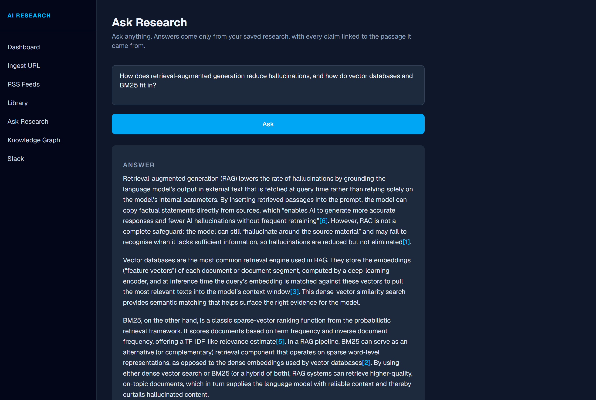
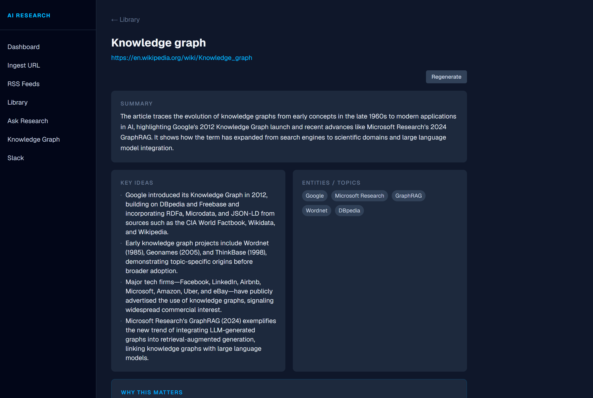
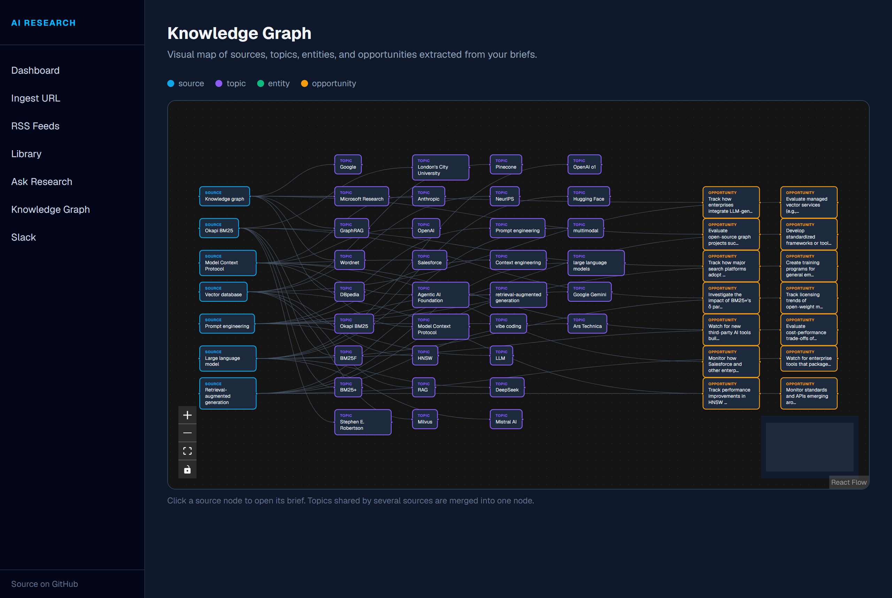
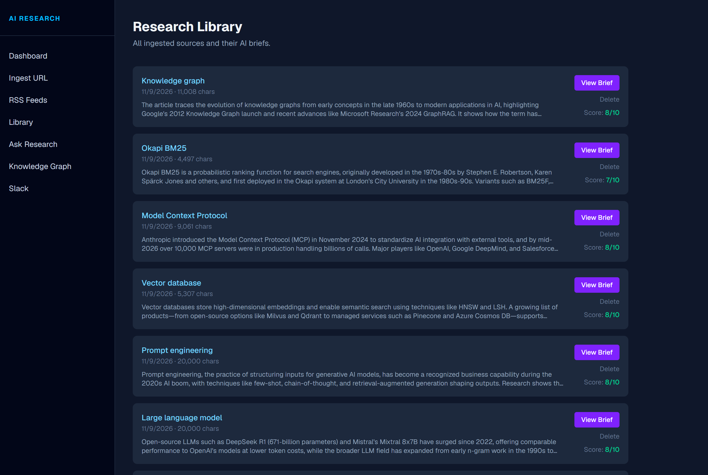

# AI Research Intelligence System

[](https://github.com/eduarduque/ai-research-system/actions/workflows/ci.yml)


A self-hosted research assistant: save articles and RSS items, get **grounded AI briefs**, ask **questions answered only from what you have saved — with every claim linked to the passage it came from** — and explore how topics connect across sources.

Runs entirely free: Groq's free tier for the LLM, and a local embedding model for semantic search (no API key). Also works with OpenAI or fully offline with Ollama.

<p align="center">
  
  
</p>
<p align="center">
  
  
</p>

## Results

Measured by the [eval harness](evals/RESULTS.md) on a fictional 28-article corpus with near-duplicate distractors, so the model can't answer from memory (38 questions, Groq `gpt-oss-20b`, local MiniLM embeddings):

| | |
|---|---|
| Retrieval Hit@1: BM25 → equal-weight hybrid → **tuned hybrid** | 91.4% → 94.3% → **100%** (in-sample sweep; see caveats) |
| Answers that cite a retrieved passage | **100%** |
| Citations pointing at a correct source | **95.7%** |
| Expected fact present in answer | **98.6%** |
| Refuses unanswerable questions | **3 / 3** |
| Briefs passing schema validation | 75% → **100%** after eval-driven fixes |
| Numbers in briefs that appear in the source | **99%** |

The [write-up](evals/RESULTS.md) separates real system fixes from fixes to the scorer, and lists the limitations.

## What's interesting here

- **Hybrid retrieval, measured.** Articles are split into overlapping, sentence-aligned chunks. Queries run BM25 *and* vector search, fused with weighted reciprocal rank fusion. The fusion weight was picked from a sweep in the eval harness, not guessed.
- **Citations you can trust.** Model output is repaired before it reaches the user: citation numbers that don't match a retrieved passage are removed, and "Sources Used" is rebuilt from what was actually retrieved. Early testing caught the model inventing sources and reusing Wikipedia's `[18]` footnote markers as citations, so both are now handled.
- **Grounded briefs.** A two-step prompt (extract names/numbers verbatim → analyze using only those), Zod validation of the JSON, and entity filtering against the source text. When no model is reachable, the fallback is *extractive* and labelled — never placeholder text masquerading as analysis.
- **Eval harness.** A fictional corpus (so the model can't answer from memory) with near-duplicate distractors, scored for retrieval quality, answer fact recall, citation precision, refusal on unanswerable questions, and brief grounding. CI runs the LLM-free part on every push and fails on regressions.
- **Safe to expose.** SSRF protection on every user-supplied URL (DNS-resolved private ranges, per-hop redirect checks), optional access token, per-IP rate limiting on LLM routes, HMAC-verified Slack events.
- **Three interfaces, one engine.** Web UI, an [MCP](https://modelcontextprotocol.io) server for Claude Desktop/Claude Code, and a Slack bot all call the same `src/lib` functions.

Design details and trade-offs: **[docs/ARCHITECTURE.md](docs/ARCHITECTURE.md)**.

## Quick start

```bash
git clone https://github.com/eduarduque/ai-research-system.git
cd ai-research-system
npm install
cp .env.example .env.local   # add a free GROQ_API_KEY from console.groq.com
npm run dev
```

Open http://localhost:3000. On first boot a few items from the default feeds are pulled in so the library isn't empty. The embedding model (~23 MB) downloads once on first use.

**Docker**

```bash
docker build -t ai-research-system .
docker run -p 3000:3000 -v research-data:/app/data -e GROQ_API_KEY=gsk_... ai-research-system
```

## How it works

```
URL / RSS item / Slack link / MCP tool call
        │
        ▼
 SSRF-checked fetch → Readability extraction → (headless Chrome if client-rendered)
        │
        ▼
 canonical URL + dedupe ──► SQLite: sources
        │
        ▼
 sentence-aligned chunks (~900 chars, overlap) ──► embeddings (local MiniLM | OpenAI | Ollama)
        │                                              stored as float32 BLOB + model id
        ▼
 Question ─► BM25 ┐
          └► cosine ┴► weighted RRF ─► top-6 passages ─► LLM ─► citation repair ─► answer
```

Full diagram and rationale in [docs/ARCHITECTURE.md](docs/ARCHITECTURE.md).

## Features

| Page | What it does |
|---|---|
| `/` | Stats, one-tap **Discover** (pull new feed items, skip anything already saved) |
| `/ingest` | Paste any URL — extracted, chunked, embedded; duplicates detected |
| `/rss` | Browse feeds; ingest an item and brief it in one click |
| `/library` | All sources; generate, regenerate or delete briefs |
| `/briefs/[id]` | Summary, key ideas, entities, why it matters, opportunity score, next action |
| `/ask` | Cited answers with the retrieved passages and the retrieval mode used |
| `/graph` | Sources → shared topics → opportunities (React Flow) |
| `/slack` | Integration status and setup |

## AI providers

Configure one in `.env.local`; the first one present wins (OpenAI → Groq → Ollama).

| Provider | LLM | Embeddings | Cost |
|---|---|---|---|
| **Groq** | `openai/gpt-oss-20b` | local MiniLM (in-process) | free tier |
| **Ollama** | any local model, e.g. `qwen2.5:7b` | `nomic-embed-text` | free, offline |
| **OpenAI** | `gpt-4o-mini` | `text-embedding-3-small` | paid |
| none | extractive briefs, passage search | local MiniLM | free |

Switching embedding models is safe: vectors are tagged with the model that produced them, and stale sources are re-indexed in the background on boot.

## Configuration

| Variable | Default | Purpose |
|---|---|---|
| `GROQ_API_KEY` / `OPENAI_API_KEY` | — | LLM provider (see above) |
| `GROQ_MODEL` / `OPENAI_MODEL` / `OLLAMA_MODEL` | see table | Override the chat model |
| `EMBEDDING_PROVIDER` | auto | Force `local`, `openai`, `ollama` or `none` |
| `HYBRID_KEYWORD_WEIGHT` | `0.25` | BM25 weight in rank fusion (vector = 1) |
| `APP_ACCESS_TOKEN` | — | Require this token (login page or `Authorization: Bearer`) |
| `RATE_LIMIT_PER_MIN` | `30` | Per-IP limit on LLM / fetch endpoints |
| `ALLOW_PRIVATE_URLS` | `false` | Allow ingesting intranet URLs (disables the SSRF block) |
| `BROWSER_SCRAPE` / `CHROME_PATH` | auto | Headless fallback for JS-rendered pages |
| `DATA_DIR` | `./data` | SQLite location |
| `SLACK_SIGNING_SECRET`, `SLACK_BOT_TOKEN`, `SLACK_WEBHOOK_URL` | — | Slack bot and weekly digest |

## MCP server

```bash
npm run mcp
```

A project-scoped `.mcp.json` is included, so opening this folder in Claude Code exposes the tools automatically.

| Tool | Description |
|---|---|
| `ingest_url` | Fetch, extract, chunk and embed a URL |
| `ask_research` | Cited RAG answer over the library |
| `generate_brief` | Structured brief for a source (`force` to regenerate) |
| `discover_latest` | Pull new items from all feeds, skipping duplicates |
| `list_sources` | Saved sources |
| `get_research_graph` | Topic/opportunity graph |

## Development

```bash
npm test                          # 83 unit + integration tests (in-memory SQLite, no network)
npm run lint && npm run typecheck
npm run eval -- --retrieval-only  # retrieval benchmark, no LLM needed
npm run eval                      # + answers and briefs with your configured LLM
```

CI (GitHub Actions) runs lint, typecheck, tests, a production build, the retrieval eval with a regression floor, and a Docker build.

## Stack

Next.js 16 (App Router) · TypeScript · SQLite (`better-sqlite3`) · transformers.js · OpenAI SDK (OpenAI/Groq/Ollama) · Zod · Mozilla Readability · Puppeteer · React Flow · Tailwind · Vitest · MCP SDK

## License

MIT
