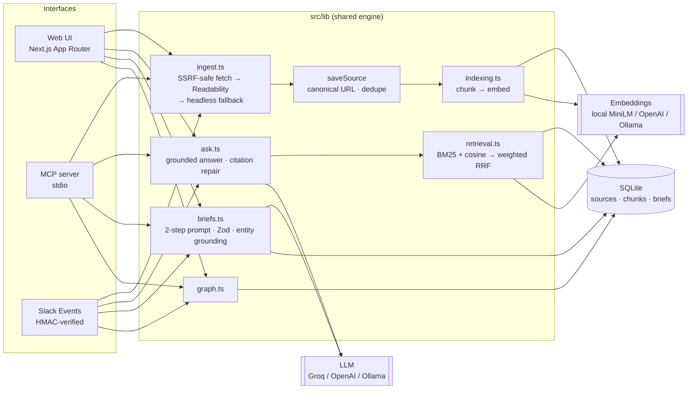

# Architecture

One engine (`src/lib/`), three front doors: the Next.js web app, an MCP server for AI assistants, and a Slack bot. Every front door calls the same functions; none re-implements ingestion, retrieval or brief generation.

## Ingestion

1. **URL canonicalization** (`url.ts`): adds a missing scheme, lowercases the host, drops fragments and tracking parameters (`utm_*`, `fbclid`, …). The canonical URL has a `UNIQUE` index, so "have I already read this?" is a single lookup and races are resolved by the database.
2. **SSRF guard**: only `http(s)`; the host is DNS-resolved and rejected if *any* address is loopback, private, link-local (cloud metadata at `169.254.169.254`), CGNAT or multicast. Redirects are followed manually and every hop is re-checked; headless-browser sub-requests go through the same check.
3. **Extraction**: Mozilla Readability over JSDOM, falling back to body text. Pages under 500 chars are assumed to be client-rendered and retried in headless Chrome if one is installed. Wikipedia-style `[12]` reference markers are stripped — left in, they collide with the answer prompt's own `[n]` citations.
4. **Indexing** (`chunk.ts`, `indexing.ts`): text is split into ~900-char chunks on paragraph → sentence → word boundaries with ~150 chars of sentence-aligned overlap. Each chunk is embedded with the title prepended. Vectors are stored as float32 BLOBs alongside the *model id* that produced them.

## Retrieval

`rankChunks()` is a pure function, so it is unit-tested and the eval harness calls it directly.

- **BM25** (k1 = 1.2, b = 0.75) over title + chunk text, with a small stopword list and a tokenizer that keeps tokens like `gpt-4o` and `u.s`.
- **Cosine similarity** against the query vector. Only vectors produced by the active embedding model are compared; switching providers triggers a background re-index instead of silently comparing incompatible spaces.
- **Weighted reciprocal rank fusion**: `score = Σ wᵢ / (60 + rankᵢ)`. The two retrievers' scores live on unrelated scales, so ranks are fused rather than scores. BM25 is weighted 0.25 relative to vectors — see [`evals/RESULTS.md`](../evals/RESULTS.md) for the sweep that chose it.
- **Diversity cap**: at most 2 chunks per source in the first pass; leftover slots are back-filled so a single relevant source still yields full context.
- **Graceful degradation**: no embedding provider, or the query embedding call fails → BM25 only. The response reports which mode ran.

## Answers

The top 6 chunks are sent as numbered excerpts with a system prompt that requires a citation on every factual sentence and an explicit "not in the sources" when the answer is missing. The raw model output is then **repaired, not trusted**:

- citation numbers that don't correspond to a retrieved excerpt are removed;
- the "Sources Used" section is rebuilt from the excerpts the answer actually cites — the model's own list is discarded (it was observed inventing sources).

## Briefs

1. **Two-step prompt**: the model first lists every name and number verbatim (`_grounding`), then writes the analysis using only those.
2. **Zod validation** with lenient coercion (string → list, `"7.6"` → 8) and a hard failure for missing summary/key ideas. The score is clamped to 1–10.
3. **Entity grounding**: entities must appear in the article text; the rest are dropped.
4. **Honest fallback**: if no model is reachable, an *extractive* brief is built from the article's own sentences, flagged `is_fallback`, labelled in the UI, and regenerated on the next request instead of being cached as if it were analysis.

## Security & operations

| Concern | Mitigation |
|---|---|
| SSRF via user URLs | DNS-resolved private-range blocklist, per-hop redirect checks (`url.ts`) |
| Quota draining | Per-IP sliding-window rate limit on LLM/fetch routes (`proxy.ts`) |
| Public exposure | Optional `APP_ACCESS_TOKEN`: bearer header or hashed `httpOnly` session cookie |
| Forged Slack events | HMAC-SHA256 verification, 5-min replay window, fail closed without a secret |
| Slack retries | `x-slack-retry-num` acknowledged without re-processing; work runs in `after()` |
| Bad input | Zod schemas on every POST body |
| Schema drift | Idempotent migrations on boot (column renames, new columns, de-duplication before the unique index) — covered by a test that opens a v1 database |

## Scaling notes

The in-process design is deliberate for a single-user research tool: SQLite + brute-force cosine over a few thousand chunks is ~ms and has no infrastructure. The seams for growing out of it are narrow:

- **Vector search**: `getAllChunks()` + `rankChunks()` → swap for `sqlite-vec` or pgvector; `rankChunks` already accepts any candidate list.
- **Rate limiting**: the `RateLimiter` class is per-process → Redis/Upstash for multiple instances.
- **Background work**: ingestion embeds inline (~100 ms per chunk locally) → a job queue if bulk imports become common.
